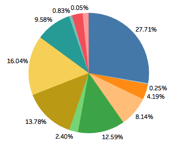
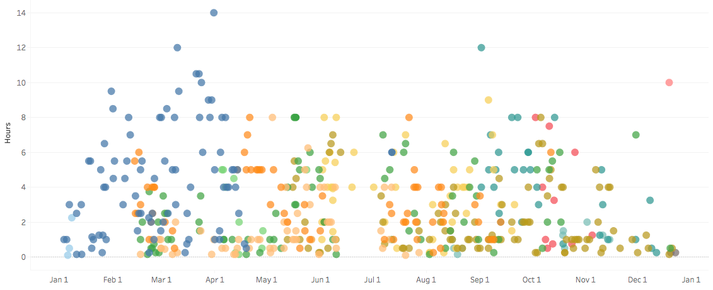
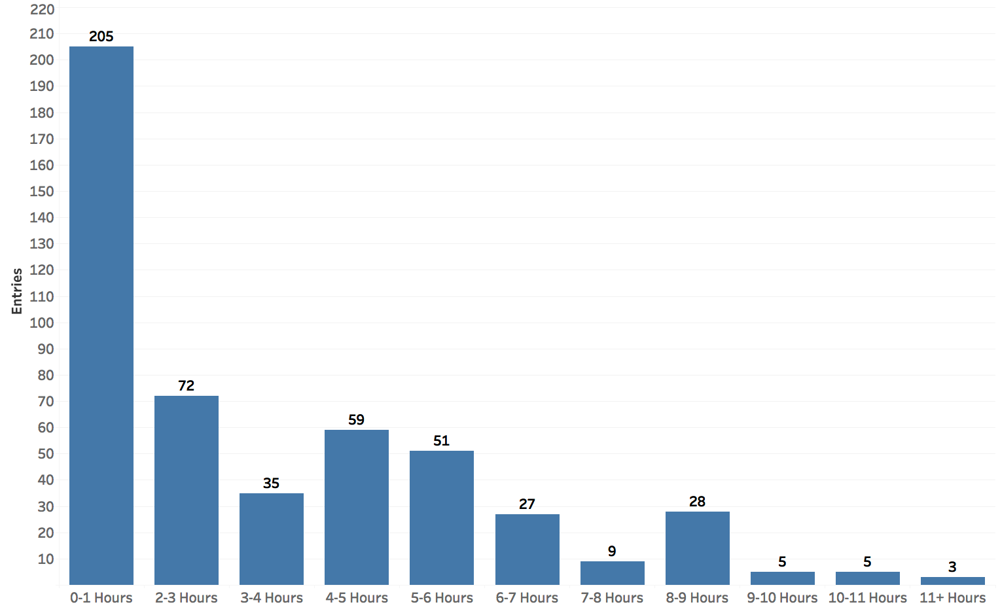
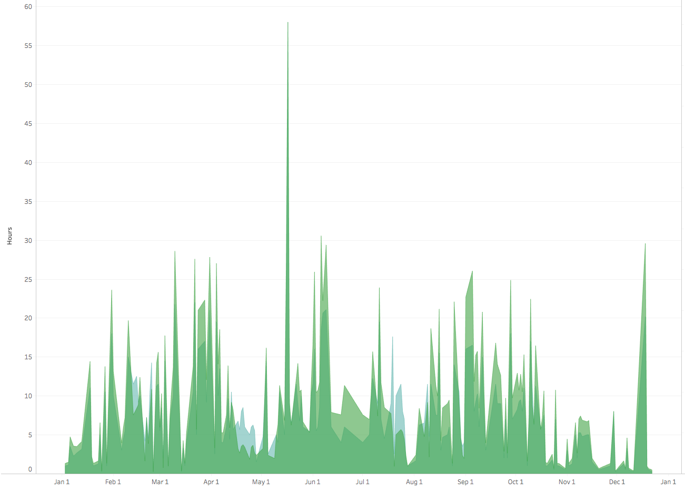
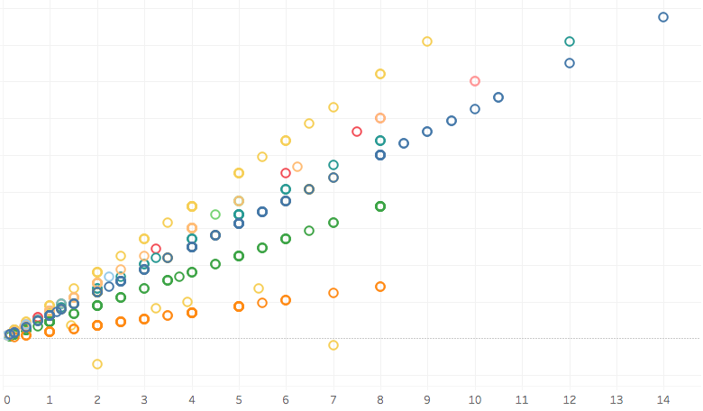

In November 2016, I left a role I genuinely loved in the Healthcare Analytics Practice at [Berkeley Research Group](https://www.thinkbrg.com). I was surrounded by sharp analysts, working on interesting pharma and medical-device problems, and had clear room to grow. Yet an itch to build on my own wouldn't go away.

## Three Reasons I Left

1. **Taking more calculated risk:** Right before I got married, my father—an internet entrepreneur himself—nudged me to take bigger professional risks while I could. Going independent solely for money isn't worth the stress (even though I earned more this year, money alone wouldn't justify it), but the autonomy changed how I think about work.
2. **Owning my intellectual property:** I wanted to cut out middlemen, charge clients fair rates, and keep ownership of the tools I built wherever contracts allowed. Immediately after leaving, I partnered with two founder-led startups on a native iOS market-access[^1] app for pharma and a higher-education Net Pricing Calculator[^2], while building a client pipeline through steady communication. (One surprise I didn't anticipate: working solo gets lonely. Joining a coworking space in Cambridge after moving north with my wife helped enormously.)
3. **Shifting from services toward software:** Throughout my consulting career, I kept noticing an awkward tension between billing hours and building software. Clients across firms share the exact same operational problems, yet traditional consultancies are rarely incentivized to automate work they can staff. The right answer is usually a hybrid: **software handles the repetitive core, and consultants tackle the hard edge cases.**

## The Year in Data

I tracked every billable hour in 2017 using [WorkDive](/development/productivity/2016/12/16/workdive.html), the SMS time-tracking app I built for myself. While I can't publish raw dollar figures, the relative patterns across **13 client projects (~1,500 billable hours)** were revealing.

### Profit Share by Project

<figure>
  
  <figcaption>Relative share of 2017 consulting profit across 13 billable projects.</figcaption>
</figure>

Roughly a quarter of total profit came from a single anchor engagement, which stabilized income for the year. Two additional side projects brought in modest supplementary revenue outside this chart.

### Daily Hours Logged Across the Calendar

<figure>
  
  <figcaption>Daily hours logged across projects throughout 2017.</figcaption>
</figure>

You can spot real life right inside the scatter plot. I visited family in Cambodia in June and mostly stayed unplugged; on an earlier trip to Portugal in March, that anchor project pulled me back in with several 8+ hour days. Notably, my two *lowest-rate* engagements (dark green and dark orange) billed the most steadily all year—combining for about 17% of total income and smoothing out the valleys.

### Entry Size Distribution

<figure>
  
  <figcaption>Distribution of individual time-entry increments logged during the year.</figcaption>
</figure>

Rather than days worked, this shows the size of each individual time block I logged. Apparently I work in small, focused bursts more often than marathon blocks.

### Hours vs. Profit Over Time

<figure>
  
  <figcaption>Daily hours (blue) alongside relative profit (green, axis cropped).</figcaption>
</figure>

Overhead stayed low—I only brought in subcontractors occasionally—so margins tracked effort closely. The sharp profit spikes come from fixed-fee milestones and high-rate sprint days, while the lower-margin stretches in spring and midsummer reflect a royalty-backed build that may pay off over time.

### Effective Rates by Project

<figure>
  
  <figcaption>Effective rate (profit divided by hours) across each 2017 project.</figcaption>
</figure>

The clearest takeaway from the entire year sat right here: **higher-rate engagements were shorter and far more intense** (with more 8+ hour crunch days), whereas lower-rate retainers were steadier and much less volatile. Balancing both is the quiet trick to surviving year one on your own.

Thank you to every client who trusted me in 2017.

[^1]: Market access evaluates payer coverage and prescribing patterns to identify barriers affecting how a therapy reaches patients.
[^2]: A Net Pricing Calculator helps prospective college students estimate out-of-pocket attendance costs after financial aid.
