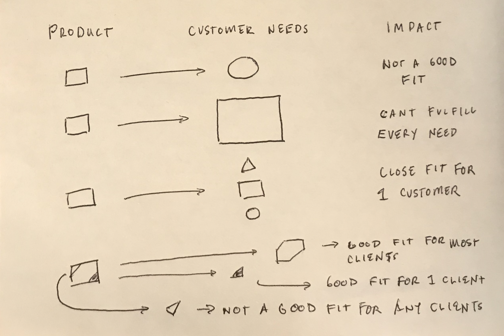

With my previous product, WorkDive, I built first and asked questions later—only to discover a crowded market full of mature competitors. With Staff Mapper, I inverted the process. Before I had a true MVP, I started emailing my network and pitching consultancies to let real customer pain drive the roadmap.

Product development began in July 2017, and customer outreach started the same month. Talking to dozens of professional services firms turned out to be the hardest—and most illuminating—part of building the company.

## What Prospects Actually Said

Rejection is clarifying when you write it down verbatim. Across dozens of calls and emails, here is a cross-section of what I heard:

- *"I'd rather visualize this inside Salesforce than adopt a standalone tool."* — CEO, Salesforce consultancy
- *"We work in small agile teams, so we don't have this problem."* — Manager, valuation firm
- *"We just finished building an in-house tool across the firm."* — Consultant, EY
- *"We thought you were a floor-planning tool."* — Inbound lead confusing us with StaffMap.com
- *"Could we use this to schedule hazardous waste pickups across labs in the Northeast?"* — Waste-management manager
- *"Our culture isn't interested in Big Brother monitoring."* — Consulting director
- *"Partners here prefer to retain individual control over their own staff."* — Practice manager
- *"We're only a team of five."* / *"We needed something immediately and went with Everhour."*

And then, finally, the email that mattered:

> "We are certainly at a point where staffing has become a burdensome process. There is a subcommittee of us trying to streamline it. Let me know if we can set up a call—certainly looking for practical solutions."
> — Partner at a consulting firm (our eventual first customer)

## Four Lessons From Early Outreach

Those conversations saved months of wasted engineering and crystallized four realities:

1. **Positioning was too vague:** Being mistaken for office floor-planning or waste-logistics software meant our value proposition wasn't sharp enough.
2. **Firm culture varies wildly:** A tool that feels like helpful visibility at one consultancy feels like micromanagement at another. Flexibility had to be built in.
3. **Integrations matter early:** Teams rarely want another isolated silo when their time and billing already live elsewhere.
4. **Know the real buyer:** I assumed HR would champion the product. In practice, **managing partners and the C-suite are always the buyers**—they feel the pain of unbilled bench time and burnout directly.

<figure>
  
  <figcaption>An early notebook sketch mapping how a single product shape fits—or misses—different client needs.</figcaption>
</figure>

## The Pitch That Closed Deal One

When that interested partner brought me in to demo for the broader partnership, I stripped the pitch down to one sentence:

> "If this helps you recoup a single billable hour of a consultant's time, the software pays for itself."

They wanted to move forward, provided we shipped a focused core first:

- Short- and long-term availability, utilization, and PTO broadcasting
- A long-term capacity calendar with forward-looking projections
- One-click staff claiming (making ROI measurable)
- Lightweight roster, skills tracking, and basic utilization reporting

They started on a **$6/user/month** trial with a handful of test users so we could iron out edge cases together. We wired Stripe to read active user counts dynamically each month as headcount fluctuated.

On **June 6, 2018**—nearly a full year after my first commit and outreach email—our first invoice went out for **$208**. Not a fortune, but proof that a real firm would pay for something I built from scratch.
